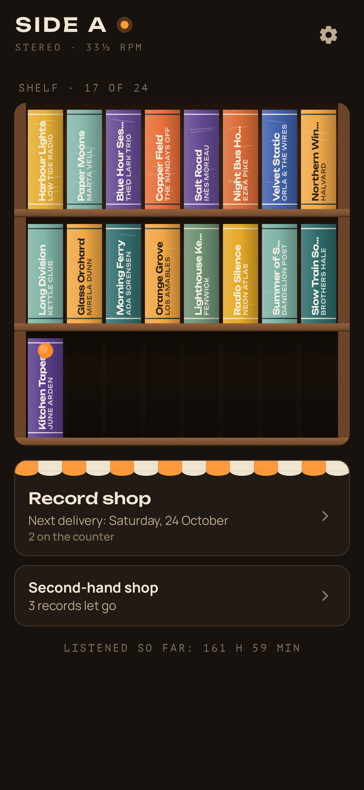
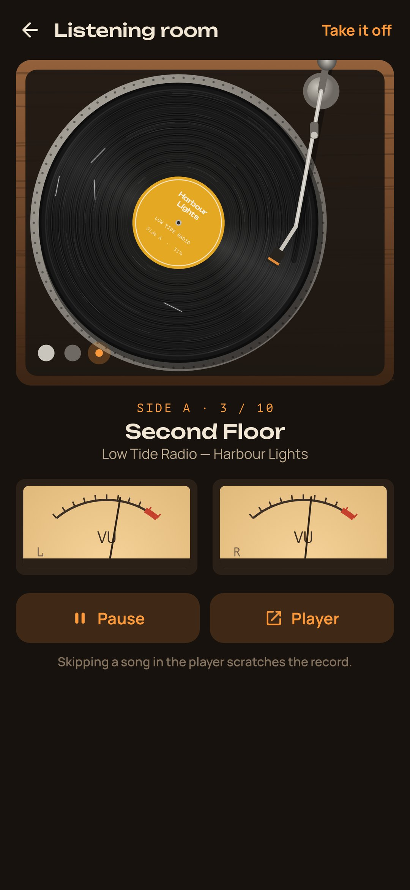
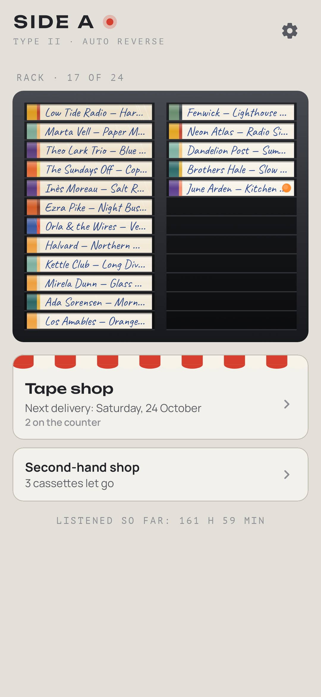
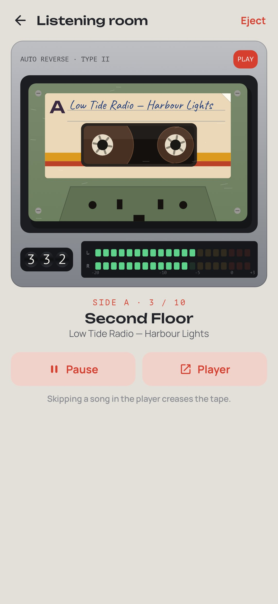

<div align="center">


# Side A

### There is too much music. Fall back in love with it.

*One album a week from the record shop, a whole side at a time, on a turntable or a tape deck. Skip a song and the record keeps the scratch; wind a cassette and it takes as long as a real deck. Records wear in as you love them, and you write a line on the inner sleeve after listening. Play your own files with real vinyl crackle, or listen along with Spotify and other players. Free, no ads, no account, no internet.*

[](https://github.com/bigdevwhale/side-a/actions/workflows/android.yml)
[](https://github.com/bigdevwhale/side-a/releases/latest)


[](LICENSE)

**English** · [Русский](README.ru.md) · [Changelog](CHANGELOG.md)

   

</div>

---

## The idea

A hundred million songs in your pocket, and hardly one heard all the way through. Music used to be loved because there was so little of it: you saved up for a record, carried it home, played it to the end, read the sleeve, played it again. Side A brings back three things from then: **scarcity, whole albums and attention**.

It doesn't sell or stream music. It's the turntable: the music is yours, from a folder on the phone or the streaming app you already use.

## Records or cassettes

Pick a look at the start, and the whole app follows: how it looks, how it sounds and what skipping does.

- **Records.** A walnut hi‑fi in a dark room, an orange stereo lamp, lit VU meters. A needle you lower and lift, a tonearm you can drag, and moving it while the needle is down scratches the record. The scratch stays, and it clicks each time round.
- **Cassettes.** A silver eighties tape deck, piano keys, a three‑wheel counter, LED meters. A cassette can't jump; it winds, about twenty times faster than it plays, so a skip takes real time. Turn it over mid‑side and it plays on from the mirrored spot, as a tape does.

Each look comes in its own light or dark, or follows the phone.

Prefer to change songs freely? Turn on **Songs by button** in settings: previous and next appear in the listening room, the needle lifts and drops by itself (no scratch), and a cassette jumps straight to the song with no winding.

## How it works

1. **The record shop.** The shop gets one delivery a week, on the day you pick. You can buy one album a week, and a week you don't use doesn't carry over. Others can wait on the counter (up to six). The first three are a gift, for the records you already own and love.
2. **Find an album.** Three ways: *from your player* (whatever Spotify, YouTube Music or Yandex Music is playing now, with its cover), *from a folder* on the phone (your own files, sorted into side A and side B), or *write the name*.
3. **The shelf.** Twenty‑four places: three walnut shelves of spines, or a black rack of cassettes with the titles in ballpoint. When it's full, one goes to the **second‑hand shop** with a farewell line. It keeps its notes and scratches, and can be bought back as a week's buy.
4. **The listening room.** Thirty seconds of silence first, to rest your ears. Then the needle drops on side A. When it runs out, turn the record over. Pick up the phone and leave the app with the screen on, and the needle goes up. Put the phone down with the screen off and the music plays on.
5. **The inner sleeve.** After a long enough sitting, write a line on the sleeve: where you were, what it brought back. A year later it'll be there.

## Records wear in

Every minute under the needle counts. With time a sleeve takes on ring wear, soft white corners, a yellowing, then creases; spines crack; the vinyl dulls and gathers hairlines; a cassette's label yellows and peels at the corner. For records from a folder you also hear it: more crackle on a worn record, more wow and flutter on a stretched tape.

## Listening along with a streaming app

With notification access (it reads only what's playing, never your notifications), Side A watches your player's media session. It recognises the album, learns its songs as they play, counts the time you listen and turns the platter. A skipped song or a jump within one scratches the record (or creases the tape), just as on a folder record. Play and pause work from the room, and picking up the phone pauses the player too.

*Play the album* in the room asks the player to start it without leaving Side A, the way a voice assistant does. Players that only take such requests from their partners (Spotify is one) get their search opened at the album instead.

### Spotify, without opening it (optional)

Spotify starts a chosen album only for apps registered with it. If you'd like that, register Side A yourself, free: *Settings → Spotify* walks you through it.

1. In [Spotify's developer dashboard](https://developer.spotify.com/dashboard), create an app (any name), tick **Android**, and add the package name, SHA‑1 fingerprint and redirect URI that the settings show (tap to copy).
2. Paste the app's **Client ID** into Side A and tap *Connect*; Spotify asks for your permission once.

From then on *Play the album* starts it in Spotify quietly, through Spotify's own [App Remote SDK](https://github.com/spotify/android-sdk), which talks to the Spotify app on the phone (Side A still has no internet permission). A record learns its Spotify address when it's added from the player or first plays there. Starting a chosen album needs Spotify Premium; an app in Spotify's development mode serves up to 25 people you add yourself.

## Real recordings

Optionally, Side A lays a **real recording** of vinyl crackle or tape hiss under the music, instead of the one made up in code. It plays under folder records and over your streaming app too, rising with wear. Both recordings are CC0 (public domain), from Freesound via GitHub; see [docs/SOUNDS.md](docs/SOUNDS.md).

## Privacy

There's no account, no ads, no analytics and no internet permission. The shelf, notes and listening times stay on the phone. Folder access is only for the folders you pick; notification access only reads the playing song.

## Building

```bash
./gradlew testDebugUnitTest assembleDebug              # app.sidea.dev, next to a real install
./gradlew assembleDebug -Pdemo                         # app.sidea.demo with a lived-in shelf of made-up records
./gradlew testDebugUnitTest -Prender --tests '*RenderArtScreens*' && python tools/shots.py   # screenshots
python tools/icon.py                                   # the logo
python tools/sfx.py                                    # the recorded loops, from tools/sfx/
```

Kotlin, Jetpack Compose, Room, DataStore, Media3 (ExoPlayer with a custom audio processor for the surface noise). Everything is drawn in code: sleeves, platter, tonearm, cassettes, meters, shelves.

## License

[MIT](LICENSE). The two recorded sounds are CC0; see [docs/SOUNDS.md](docs/SOUNDS.md). `app/libs/spotify-app-remote-release-0.8.0.aar` is Spotify's App Remote SDK, Apache‑2.0, from [spotify/android-sdk](https://github.com/spotify/android-sdk).
