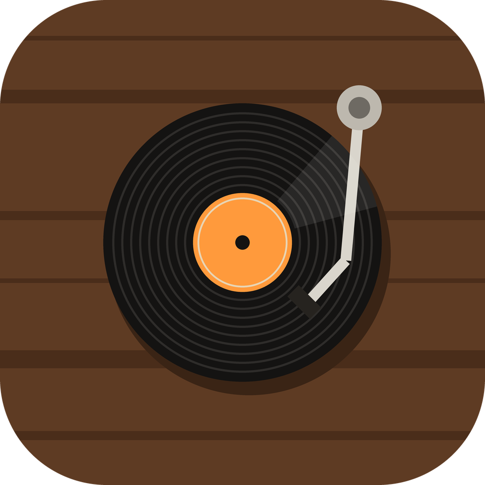
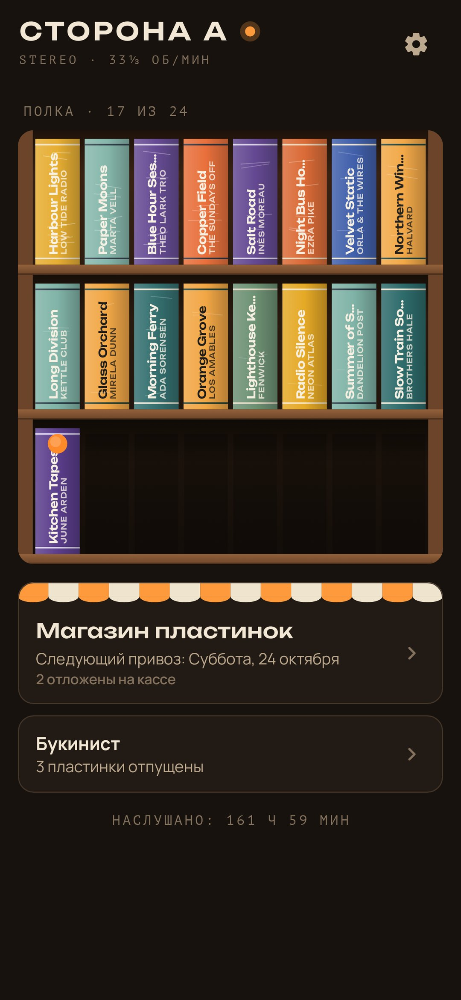
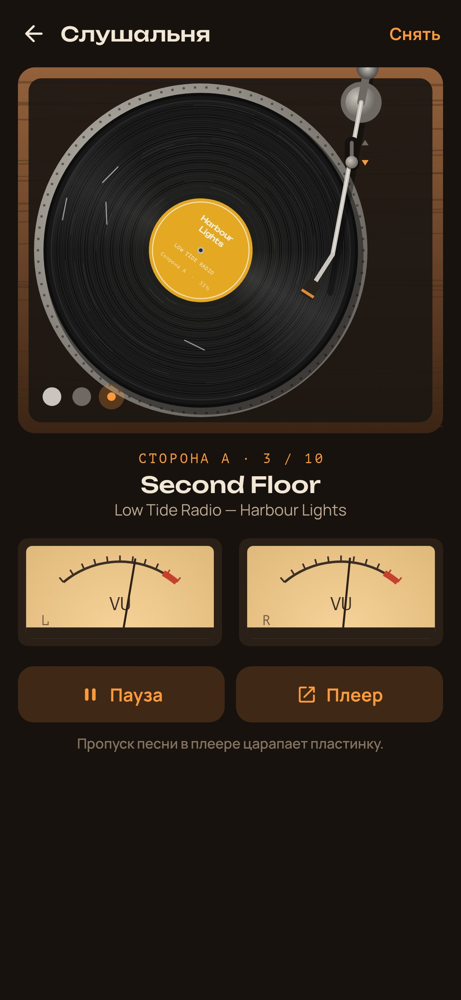
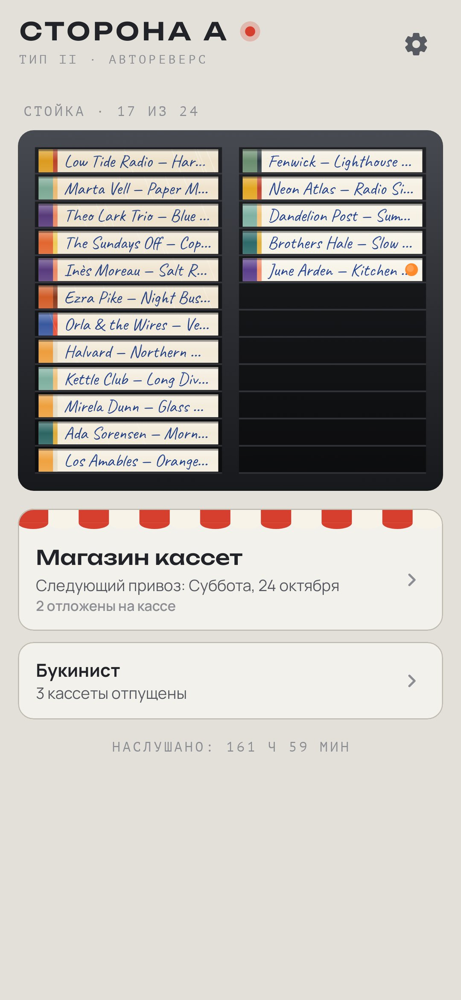
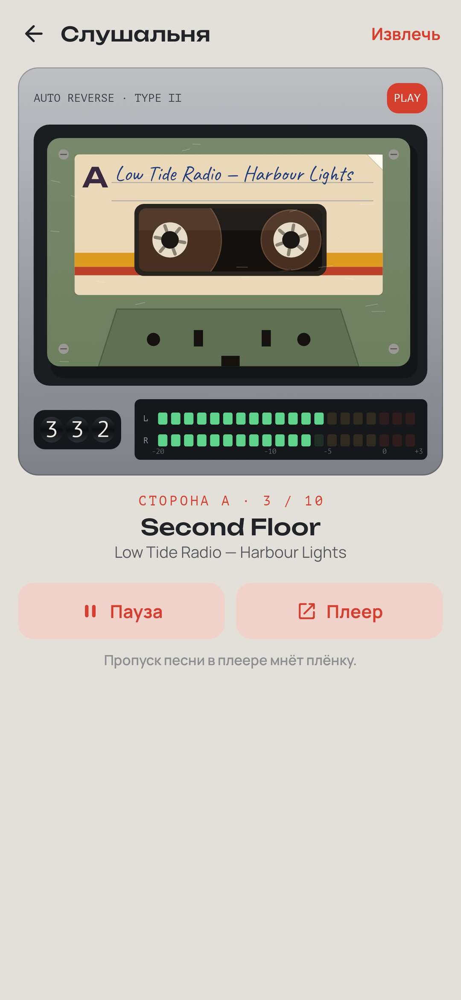

<div align="center">



# Сторона А

### Музыки стало слишком много. Влюбиться в неё снова.

*Один альбом в неделю из магазина пластинок, сторона целиком — на вертушке или в кассетной деке. Пропустишь песню, и на пластинке останется царапина. Перемотка кассеты идёт столько же, сколько на настоящей деке. Пластинки стареют от любви, а после прослушивания на внутреннем конверте можно оставить строчку. Свои файлы играют с настоящим треском винила, а со Spotify и другими плеерами можно слушать вместе. Бесплатно, без рекламы, без аккаунта и без интернета.*

[](https://github.com/bigdevwhale/side-a/actions/workflows/android.yml)
[](https://github.com/bigdevwhale/side-a/releases/latest)


[](LICENSE)

[English](README.md) · **Русский** · [Изменения](CHANGELOG.md)

   

</div>

---

## Идея

Сто миллионов песен в кармане — и почти ни одной, дослушанной до конца. Раньше музыку любили, потому что её было мало: копили на пластинку, несли домой, слушали до конца, разглядывали конверт, ставили снова. «Сторона А» возвращает три вещи из того времени: **дефицит, альбом целиком и внимание**.

Музыку приложение не продаёт и не стримит. Оно — вертушка, а музыка твоя: из папки на телефоне или из стриминга, которым ты уже пользуешься.

## Пластинки или кассеты

В начале выбираешь эстетику, и под неё подстраивается всё: внешний вид, звук и то, что бывает при пропуске.

- **Пластинки.** Ореховый проигрыватель в тёмной комнате, оранжевая лампа «stereo», подсвеченные VU-стрелки. Иглу опускаешь и поднимаешь, тонарм можно тянуть. Двинешь его с опущенной иглой — пластинка поцарапается. Царапина останется и будет щёлкать на каждом обороте.
- **Кассеты.** Серебристая дека восьмидесятых, клавиши, механический счётчик, светодиодные индикаторы. Кассета не умеет прыгать, она перематывается: примерно в двадцать раз быстрее воспроизведения, так что пропуск отнимает настоящее время. Перевернёшь посреди стороны — заиграет с зеркального места, как на настоящей плёнке.

У каждой эстетики своя светлая и тёмная тема, можно и как в системе.

Хочется переключать песни свободно? Включи в настройках **«Песни по кнопке»**: в слушальне появятся «назад» и «дальше», игла сама поднимется и опустится (без царапин), а кассета перейдёт к песне сразу, без перемотки.

## Как это работает

1. **Магазин пластинок.** Привоз раз в неделю, в выбранный день. Купить можно один альбом в неделю, и неиспользованная неделя не копится. Остальные можно отложить на кассе (до шести). Первые три — в подарок: для пластинок, которые уже твои и любимы.
2. **Найти альбом.** Три способа. *Из плеера*: что сейчас играет в Spotify, YouTube Music или Яндекс Музыке, вместе с обложкой. *Из папки* на телефоне: свои файлы, разложенные на сторону А и Б. Или *вписать название*.
3. **Полка.** Двадцать четыре места: три ореховые полки с корешками или чёрная стойка с кассетами, подписанными шариковой ручкой. Когда места нет, одна отправляется в **букинист** с прощальной строчкой. Заметки и царапины остаются при ней, и её можно выкупить в счёт недельной покупки.
4. **Слушальня.** Сначала тридцать секунд тишины, чтобы уши отдохнули. Потом игла опускается на сторону А. Когда сторона заканчивается, пластинку надо перевернуть. Возьмёшь телефон и выйдешь из приложения с включённым экраном — игла поднимется. Выключишь экран и положишь телефон — музыка играет дальше.
5. **Внутренний конверт.** После долгого прослушивания можно оставить строчку на конверте: где это было, что вспомнилось. Через год она найдётся здесь.

## Пластинки стареют

Каждая минута под иглой засчитывается. Со временем на конверте проступает кольцо от диска, белеют уголки, бумага желтеет, а потом появляются заломы. Корешки трескаются, винил тускнеет и покрывается волосками царапин, этикетка кассеты желтеет и отклеивается с угла. У альбомов из папки износ ещё и слышно: потёртая пластинка трещит сильнее, растянутая плёнка «плавает».

## Вместе со стримингом

С доступом к уведомлениям (читается только играющая песня, сами уведомления — никогда) «Сторона А» следит за медиасессией плеера. Она узнаёт альбом, запоминает его песни по мере звучания, считает время прослушивания и крутит пластинку. Пропуск песни или прыжок внутри неё царапает пластинку (или мнёт плёнку), как и у альбома из папки. Играть и ставить на паузу можно прямо из слушальни, а взятый в руки телефон ставит на паузу и плеер.

Кнопка *«Включить альбом»* просит плеер запустить альбом, не уходя из «Стороны А», — так, как это делает голосовой ассистент. Плееры, которые принимают такие просьбы только от партнёров (Spotify из их числа), вместо этого открывают поиск на нужном альбоме.

### Spotify, не открывая его (по желанию)

Выбранный альбом Spotify запускает только для зарегистрированных у него приложений. Если хочется так, зарегистрируй «Сторону А» сам, бесплатно: в *Настройках → Spotify* есть пошаговая подсказка.

1. В [кабинете разработчика Spotify](https://developer.spotify.com/dashboard) создай приложение (название любое), отметь **Android** и вставь имя пакета, отпечаток SHA‑1 и redirect URI из настроек (нажми, чтобы скопировать).
2. Вставь **Client ID** этого приложения в «Сторону А» и нажми «Подключить» — Spotify один раз спросит разрешение.

После этого «Включить альбом» запускает его в Spotify тихо — через официальный [App Remote SDK](https://github.com/spotify/android-sdk), который общается с приложением Spotify на телефоне (доступа в интернет у «Стороны А» по-прежнему нет). Адрес альбома в Spotify пластинка узнаёт, когда её добавляют из плеера или когда она впервые там звучит. Для запуска выбранного альбома нужен Spotify Premium; приложение в режиме разработчика доступно до 25 людям, которых добавляешь сам.

## Настоящие записи

По желанию «Сторона А» подкладывает под музыку **настоящую запись** треска винила или шипения плёнки вместо синтезированной. Запись звучит и под альбомами из папки, и поверх стриминга, и становится громче с износом. Обе записи под CC0 (общественное достояние), с Freesound через GitHub; подробности в [docs/SOUNDS.md](docs/SOUNDS.md).

## Приватность

Без аккаунта, рекламы, аналитики и доступа в интернет. Полка, заметки и время прослушивания остаются на телефоне. Доступ к папкам — только к выбранным, доступ к уведомлениям — только к играющей песне.

## Сборка

```bash
./gradlew testDebugUnitTest assembleDebug              # app.sidea.dev, рядом с настоящей установкой
./gradlew assembleDebug -Pdemo                         # app.sidea.demo с обжитой полкой выдуманных пластинок
./gradlew testDebugUnitTest -Prender --tests '*RenderArtScreens*' && python tools/shots.py   # скриншоты
```

## Лицензия

[MIT](LICENSE). Две записанные звуковые петли — CC0, см. [docs/SOUNDS.md](docs/SOUNDS.md). `app/libs/spotify-app-remote-release-0.8.0.aar` — Spotify App Remote SDK под Apache‑2.0 из [spotify/android-sdk](https://github.com/spotify/android-sdk).
